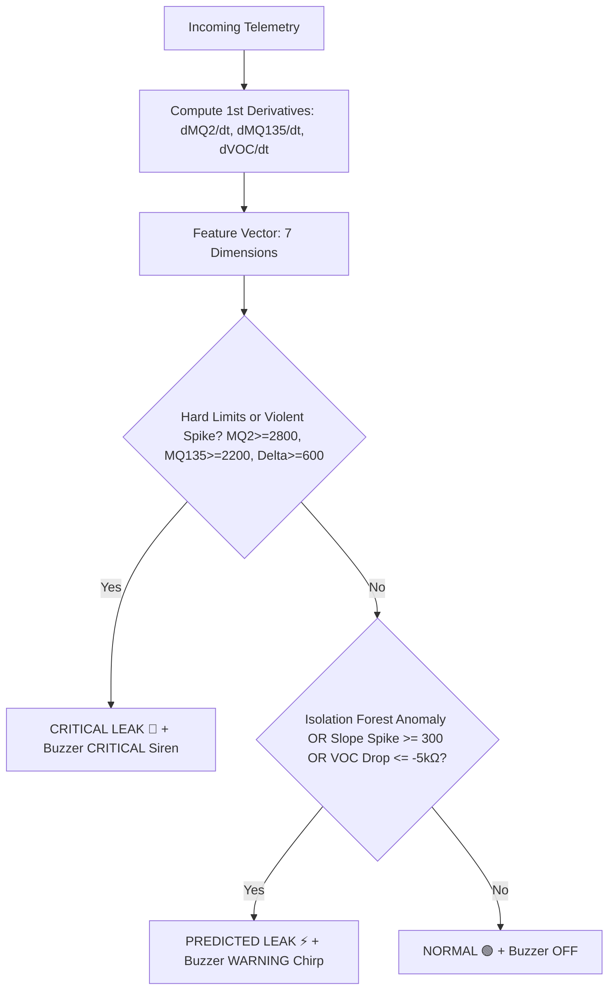

# 🏭 KRM Air Monitor — Industrial AI Leak Warning & Buzzer Alarm System

> **A production-ready, real-time industrial telemetry web application with on-device ESP32 edge processing, adaptive Isolation Forest AI anomaly detection, rate-of-change (dGas/dt) slope analysis, hardware active/passive buzzer alarm (GPIO 23), 16x4 I2C LCD local display, and a modern industrial dark-mode dashboard with browser audio synthesis.**

---

## 📑 Table of Contents
1. [System Architecture](#1-system-architecture)
2. [Directory Structure](#2-directory-structure)
3. [Hardware & Wiring Diagram](#3-hardware--wiring-diagram)
4. [Buzzer Alarm & Spike Trigger Engine](#4-buzzer-alarm--spike-trigger-engine)
5. [Backend Deep Dive (`app.py`)](#5-backend-deep-dive-apppy)
6. [AI / ML Leak Prediction Engine](#6-ai--ml-leak-prediction-engine)
7. [Frontend Dashboard (`static/index.html`)](#7-frontend-dashboard-staticindexhtml)
8. [ESP32 Firmware (`krm_air_monitor.ino`)](#8-esp32-firmware-krm_air_monitorino)
9. [API Endpoints Reference](#9-api-endpoints-reference)
10. [Installation & Setup Guide](#10-installation--setup-guide)
11. [Troubleshooting & FAQ](#11-troubleshooting--faq)

---

## 1. System Architecture

```
                                  LOCAL WI-FI NETWORK
                                           │
  ┌─────────────────────────┐              │             ┌─────────────────────────┐
  │      ESP32 EDGE         │              │             │     PYTHON BACKEND      │
  │                         │              │             │      (FastAPI)          │
  │  • MQ-2 (ADC 34)        │─── HTTP ────►│────────────►│  • Ingestion Buffer     │
  │  • MQ-135 (ADC 35)      │    POST      │  Port 5000  │  • First Derivatives    │
  │  • BME680 (I2C 21/22)   │   /telemetry │             │  • Isolation Forest AI  │
  │  • 16x4 LCD Display     │◄── JSON ─────│◄────────────│  • Rule-Based Classifier│
  │  • Buzzer Alarm (GPIO23)│   Directives │             │  • Spike & Alarm Rules  │
  └─────────────────────────┘              │             └────────────┬────────────┘
                                           │                          │
                                           │                   HTTP GET Poll
                                           │                     /telemetry
                                           │                          │
                                           │             ┌────────────▼────────────┐
                                           │             │   SINGLE PAGE APP       │
                                           │             │  (Tailwind + Chart.js)  │
                                           │             │                         │
                                           │             │  • Web Audio Siren Synth│
                                           │             │  • Real-time KPI Cards  │
                                           │             │  • dGas/dt Spike Trends │
                                           │             │  • Multi-Axis Line Graph│
                                           │             │  • Dynamic Risk Banner  │
                                           └─────────────┴─────────────────────────┘
```

---

## 2. Directory Structure

```
d:/KRM Projects/krm_air_monitor/
├── app.py                      # FastAPI server & Isolation Forest AI + Spike Alarm Engine
├── requirements.txt            # Python package dependencies
├── run.bat                     # 1-Click Windows execution script
├── static/
│   └── index.html              # Industrial dark-mode SPA + Web Audio Alarm Synthesizer
├── esp32_firmware/
│   └── krm_air_monitor.ino     # ESP32 C++ sketch (Sensors + Buzzer + LCD + Edge Safety)
└── README.md                   # Full system documentation
```

---

## 3. Hardware & Wiring Diagram

### 🔌 Pinout Mapping

| Component | Function | ESP32 Pin | Interface / Notes |
| :--- | :--- | :--- | :--- |
| **Buzzer** | **Hardware Audible Alarm** | `GPIO 23` | Active or Passive Buzzer (Digital Output / Transistor Driver) |
| **MQ-2** | Combustible / Flammable Gas | `GPIO 34` | ADC1_CH6 (12-bit, 16x oversampled) |
| **MQ-135** | Air Quality / Toxic Gases | `GPIO 35` | ADC1_CH7 (12-bit, 16x oversampled) |
| **BME680** | Temp, Humidity, Pressure, VOC | `GPIO 21 (SDA)`<br>`GPIO 22 (SCL)` | I2C Bus (Address `0x77` or `0x76`) |
| **16x4 LCD** | Local Telemetry & AI Status | `GPIO 21 (SDA)`<br>`GPIO 22 (SCL)` | I2C Backpack (Address `0x27` or `0x3F`) |
| **Power** | 5V Rail | `VIN / 5V` | MQ-2, MQ-135, LCD Backpack, Buzzer VCC |
| **Power** | 3.3V Rail | `3V3` | BME680 Sensor Module |
| **Ground** | Common Ground | `GND` | Common Ground for all components |

### 📐 Schematic & Connection Diagram

```
   ┌────────────────────────────────────────────────────────┐
   │                       ESP32 DEVKIT                     │
   │                                                        │
   │   GPIO 34 ◄──────────────── MQ-2 Analog Out (AOUT)     │
   │   GPIO 35 ◄──────────────── MQ-135 Analog Out (AOUT)   │
   │                                                        │
   │   GPIO 21 ───────────────── SDA (BME680 + 16x4 LCD)    │
   │   GPIO 22 ───────────────── SCL (BME680 + 16x4 LCD)    │
   │                                                        │
   │   GPIO 23 ───────────────── (+) BUZZER Pin (Alarm)     │
   │                                                        │
   │   5V (VIN) ──────────────── VCC (MQ-2, MQ-135, LCD)    │
   │   3.3V     ──────────────── VIN (BME680)               │
   │   GND      ──────────────── Common Ground (All (-)Pins)│
   └────────────────────────────────────────────────────────┘
```

> **Tip for Active Buzzer:** Connect positive (+) pin to `GPIO 23` and negative (-) pin to `GND`. For high-decibel sirens, drive through an NPN 2N2222 transistor connected to the 5V rail.

---

## 4. Buzzer Alarm & Spike Trigger Engine

The buzzer implements **Dual-Layer Edge & Server Triggering**:
1. **Edge-Level Instant Reaction (ESP32)**: The firmware calculates real-time slope spikes ($\Delta\text{MQ2} \ge 300$, $\Delta\text{MQ135} \ge 300$) directly on the ESP32. Even if Wi-Fi disconnects, the buzzer triggers instantly without latency.
2. **Server-Level AI Reaction (FastAPI + Isolation Forest)**: The backend evaluates multi-dimensional anomalies, rapid VOC collapse ($\Delta\text{VOC} \le -5.0\text{ k}\Omega$), and machine learning flags, sending alarm directives back in HTTP response.
3. **Web Dashboard Sound (Browser Web Audio API)**: The web UI synthesizes audible industrial alarm sounds directly inside the browser with volume toggle and mute controls.

### Alarm Modes & Sound Patterns

| Mode | Sound Pattern | Trigger Conditions | Visual Indicators |
| :--- | :--- | :--- | :--- |
| **OFF (Standby)** | Silent | Normal baseline conditions. All derivatives within safe delta range. | 🛡️ Green Glow & `Buzzer: Standby` |
| **WARNING** | Double-Beep Warning Pulse<br>*(120ms ON, 80ms OFF, 120ms ON, 800ms OFF)* | • Micro-leak detected<br>• Moderate gas rate-of-change ($\Delta\text{MQ} \ge 300$)<br>• Fast VOC resistance drop ($\Delta\text{VOC} \le -5.0\text{ k}\Omega$)<br>• Isolation Forest anomaly flag ($label = -1$) | ⚡ Amber Glow & Pulsing Amber Audio Wave Badge |
| **CRITICAL** | Continuous High-Speed Siren Strobe<br>*(100ms ON, 100ms OFF rapid strobe)* | • Violent gas spike ($\Delta\text{MQ} \ge 600$)<br>• Hard threshold exceeded ($\text{MQ2} \ge 2800$ or $\text{MQ135} \ge 2200$) | 🚨 Flashing Red Strobe, Flashing Siren Badge, LCD Speaker Icon |

 ---

## 5. Backend Deep Dive (`app.py`)

The backend is built with **FastAPI** running on **Uvicorn**, designed for high throughput, low latency, and robust error tolerance.

### Key Components:
1. **In-Memory Rolling Deque (`buffer = deque(maxlen=60)`)**:
   - Holds the 60 most recent telemetry records.
   - Computes instant first-order rate-of-change derivatives ($\Delta\text{MQ2}$, $\Delta\text{MQ135}$, $\Delta\text{VOC}$) comparing the incoming frame against the previous frame.
2. **Dynamic Ingestion (`POST /api/telemetry`)**:
   - Enriches the raw sensor frame with timestamps, derivatives, AI score, `buzzer_triggered`, `buzzer_mode`, and `spike_detected`.
   - Returns actionable directives to the ESP32.
3. **Simulation Engine (`POST /api/simulate`)**:
   - Allows testing all buzzer patterns (`normal`, `leak_early`, `critical_leak`, `recovery`) with one click from the UI.

---

## 6. AI / ML Leak Prediction Engine

### 🧠 Hybrid Classifier Architecture



### 7-Dimensional Feature Vector:
$$\vec{x} = \begin{bmatrix} \text{MQ2}, & \text{MQ135}, & \text{Temperature}, & \text{Humidity}, & \text{VOC Resistance}, & \Delta\text{MQ2}, & \Delta\text{MQ135} \end{bmatrix}$$

---

## 7. Frontend Dashboard (`static/index.html`)

The dashboard is built as an ultra-responsive industrial dark-mode Single Page Application.

### Features:
- **Web Audio API Buzzer Synthesizer**: Produces realistic alarm tones in the browser with Mute/Unmute toggle and instant audio test button.
- **Hardware Buzzer Status Card**: Displays real-time GPIO 23 state (`PIN HIGH` / `PIN LOW`), active pattern, and spike trigger alerts.
- **Top Bar**: Live connection badge, audio state badge, live IP display, and simulation controls.
- **Spike Alert Banners**: Flashing alert indicators on KPI cards and rate-of-change widgets when $\Delta\text{Gas} \ge 300$.
- **Real-Time Chart.js Graph**: Multi-axis time series plotting MQ-2, MQ-135, and VOC across the last 30 intervals with gradient fills.

---

## 8. ESP32 Firmware (`krm_air_monitor.ino`)

The firmware runs an asynchronous loop on the ESP32 to read analog and I2C sensors, format JSON telemetry, transmit over HTTP, sound the hardware buzzer, and update the 16x4 I2C LCD.

### Key Logic & Features:
- **Non-Blocking Buzzer Engine (`updateBuzzerPattern`)**: Uses `millis()` state machine timing to oscillate the buzzer pin without blocking sensor reads or HTTP requests.
- **Boot Chirp Confirmation**: Sounds 2 quick confirmation chirps at startup to verify buzzer circuit integrity.
- **Dual-Page LCD Display (Swaps every 4 seconds)**:
  - **Page 1 (Sensor Telemetry + Speaker Icon):**
    ```
    🔥 KRM Air Mon 🔊
    G1:0110  G2:1148
    🌡 33.7C  H:100.0%
    0624hPa  V: 0.0
    ```
  - **Page 2 (AI Risk, Buzzer Mode & Server Heartbeat):**
    ```
    🔊 ALARM: CRIT! 
    🚨 CRITICAL LEAK!
    📶 192.168.1.50 
    ❤ Srv:OK BUZZ:ON
    ```

---

## 9. API Endpoints Reference

### 1. Ingest Telemetry
- **Endpoint:** `POST /api/telemetry`
- **Payload:**
  ```json
  {
    "mq2": 450,
    "mq135": 380,
    "temperature": 28.5,
    "humidity": 62.3,
    "pressure": 1013.25,
    "voc_gas_kohm": 48.7
  }
  ```
- **Response (`201 Created`):**
  ```json
  {
    "status": "ok",
    "ai_status": "NORMAL",
    "buzzer_triggered": false,
    "buzzer_mode": "OFF",
    "spike_detected": false,
    "records_buffered": 12
  }
  ```

### 2. Fetch Latest Status
- **Endpoint:** `GET /api/telemetry/latest`
- **Response (`200 OK`):**
  ```json
  {
    "connected": true,
    "last_seen_seconds_ago": 1.2,
    "record": {
      "timestamp": "2026-09-30T00:38:21.240733+00:00",
      "epoch": 1790728701.24,
      "mq2": 3120,
      "mq135": 2450,
      "temperature": 33.7,
      "humidity": 60.0,
      "pressure": 1012.0,
      "voc_gas_kohm": 12.0,
      "delta_mq2": 650.0,
      "delta_mq135": 420.0,
      "delta_voc": -14.0,
      "ai_status": "CRITICAL LEAK",
      "ai_score": -0.045,
      "buzzer_triggered": true,
      "buzzer_mode": "CRITICAL",
      "spike_detected": true
    }
  }
  ```

### 3. Fetch Historical Buffer
- **Endpoint:** `GET /api/telemetry/history?limit=30`

### 4. Trigger Simulation Scenario
- **Endpoint:** `POST /api/simulate?scenario=critical_leak`
- **Parameters:** `scenario` = `normal` | `leak_early` | `critical_leak` | `recovery`

---

## 10. Installation & Setup Guide

### 1. Start the Backend Server
#### Quick Start (Windows):
Double-click [`run.bat`](file:///d:/KRM%20Projects/krm_air_monitor/run.bat). It automatically creates the virtual environment, installs packages, and launches the server.

#### Manual Terminal Start:
```powershell
cd "d:\KRM Projects\krm_air_monitor"
python -m venv venv
venv\Scripts\activate
pip install -r requirements.txt
python app.py
```
*The server will be listening at **`http://0.0.0.0:5000`**.*

### 2. Open the Web Dashboard
Open your browser and navigate to:
**`http://localhost:5000`**

### 3. Flash the ESP32
1. Open [`esp32_firmware/krm_air_monitor.ino`](file:///d:/KRM%20Projects/krm_air_monitor/esp32_firmware/krm_air_monitor.ino) in **Arduino IDE**.
2. Install the required libraries via `Sketch → Include Library → Manage Libraries`:
   - `Adafruit BME680 Library` (and `Adafruit Unified Sensor`)
   - `LiquidCrystal I2C` (by Frank de Brabander)
   - `ArduinoJson` (by Benoît Blanchon, v7+)
3. Connect the Buzzer positive pin to **`GPIO 23`** and ground pin to **`GND`**.
4. Edit the top configuration lines with your network credentials and PC IP:
   ```cpp
   const char* WIFI_SSID     = "Your_WiFi_Name";
   const char* WIFI_PASSWORD = "Your_WiFi_Password";
   const char* SERVER_HOST   = "192.168.1.100";  // IP of your PC running app.py
   #define BUZZER_PIN        23                  // GPIO 23 Buzzer Pin
   ```
5. Select board **ESP32 Dev Module** and the correct COM Port, then click **Upload**.

---

## 11. Troubleshooting & FAQ

#### Q: How can I test the buzzer without physical gas leaks?
- In the web dashboard at `http://localhost:5000`, click **"Trigger Gas Spike (Buzzer ON)"** or **"Simulate Micro-Leak"**. The web dashboard will sound the audible alarm through your speakers and the ESP32 buzzer will fire immediately.
- You can also click the **"🔔 Test Alarm"** button in the dashboard header to test browser audio synthesis.

#### Q: The buzzer on the ESP32 is too quiet.
- An active 5V buzzer driven directly from a 3.3V GPIO produces moderate volume. For maximum industrial loudness (>85dB), connect the buzzer to the 5V VIN rail and switch its ground through an NPN 2N2222 or 2N3904 transistor with a 1kΩ base resistor to `GPIO 23`.

#### Q: How do spikes trigger the buzzer immediately?
- Both the ESP32 edge firmware and the Python FastAPI backend calculate first-order derivatives ($\Delta\text{MQ2}/\Delta t$ and $\Delta\text{MQ135}/\Delta t$). If the slope exceeds $+300\text{ ADC/interval}$, the buzzer triggers a Warning alert; if it exceeds $+600\text{ ADC/interval}$ or crosses hard thresholds, it activates the Critical emergency siren.
